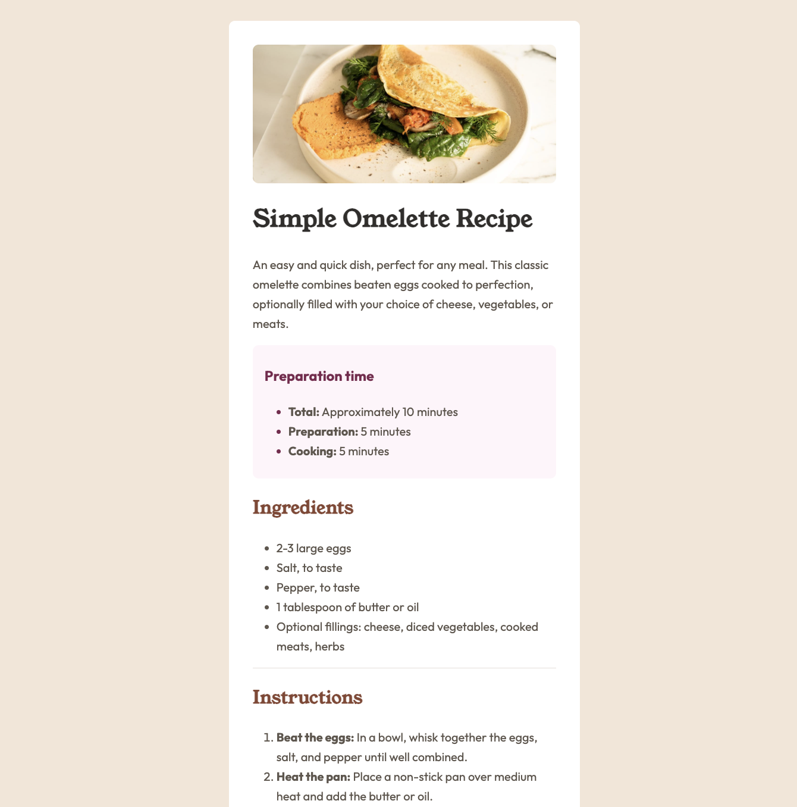

# Frontend Mentor - Recipe page solution

This is a solution to the [Recipe page challenge on Frontend Mentor](https://www.frontendmentor.io/challenges/recipe-page-KiTsR8QQKm). Frontend Mentor challenges help you improve your coding skills by building realistic projects.

## Table of contents

- [Frontend Mentor - Recipe page solution](#frontend-mentor---recipe-page-solution)
  - [Table of contents](#table-of-contents)
    - [Screenshot](#screenshot)
    - [Links](#links)
  - [My process](#my-process)
    - [Built with](#built-with)
    - [What I learned](#what-i-learned)
    - [Continued development](#continued-development)
    - [Useful resources](#useful-resources)
    - [AI Collaboration](#ai-collaboration)
  - [Author](#author)

### Screenshot



### Links

- Solution URL: [Recipe page](https://github.com/dekzyd/recipe)
- Live Site URL: [Recipe Page Live](https://dekzyd.github.io/recipe/)

## My process

### Built with

- Semantic HTML5 markup
- CSS custom properties
- Mobile-first workflow

### What I learned

I learnt how to add custom fonts, how to manipulate tables, how to implement responsive font-sizing using the clamp fxn.

```css
.font-size: clamp(0.675rem, 0.675rem + 1.5vw, 0.85rem);
```

### Continued development

I'll continue working on responsive design for fonts and table.

### Useful resources

- [Example resource 1](https://web.dev/learn/design/typography) - This helped me for styling and sizing fonts. I really liked this pattern and will use it going forward.
- [Example resource 2](https://css-tricks.com/complete-guide-table-element/) - This is an amazing article which helped me understand tables. I'd recommend it to anyone still learning tables.

### AI Collaboration

Describe how you used AI tools (if any) during this project. This helps demonstrate your ability to work effectively with AI assistants.

- What tools did you use?
  ChatGpt, Gemini and Copilot.
- How did you use them?
  I used copilot for HTML code completion, ChatGpt for styling solutions and Gemini for links to articles.

## Author

- Website - [Adekoya Oladayo](https://www.your-site.com)
- Frontend Mentor - [@dekzyd](https://www.frontendmentor.io/profile/dekzyd)
